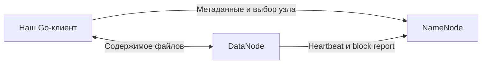
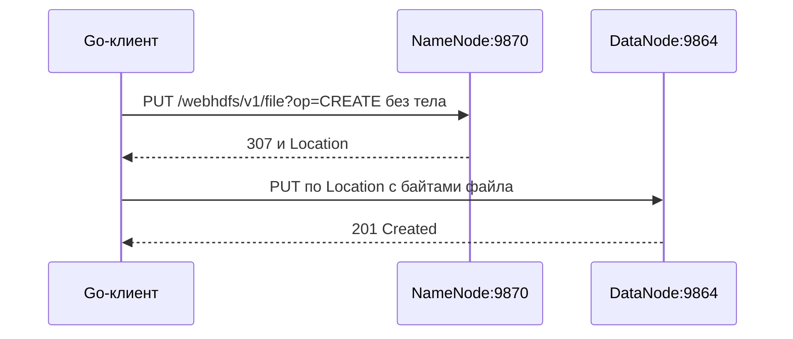

# Теория к первой практике: HDFS и WebHDFS-клиент

Конспект связан с [заданием](task1.md) и текущей реализацией проекта на Go. Его удобно читать последовательно, а перед защитой повторить вопросы в конце.

**1. Что нужно сделать в этой практике**

Разработать интерактивный клиент, который принимает сервер, порт и имя пользователя, работает с локальными файлами и файлами HDFS и обращается к Hadoop через WebHDFS REST API.

Обязательные команды: `mkdir`, `put`, `get`, `append`, `delete`, `ls`, `cd`, `lls`, `lcd`. По заданию аргументы содержат только имена, без `/`; для перехода на уровень выше разрешено `..`.

В проекте дополнительно реализованы `cat`, локальные варианты операций, справка и история команд. Запуск всего окружения и клиента:

```bash
make pr1
```

**2. Что такое HDFS и зачем она нужна**

HDFS расшифровывается как Hadoop Distributed File System. Она предоставляет общее дерево файлов и каталогов, хотя содержимое файлов распределено по дискам нескольких серверов.

Смысл распределённого хранения: объём данных и пропускная способность могут расти при добавлении серверов. Для аналитики часто нужно последовательно прочитать большой набор данных; здесь важна скорость обработки всего объёма.

HDFS рассчитана на крупные файлы, потоковое чтение и отказы оборудования. Для частого изменения отдельных байтов и большого количества маленьких файлов обычно выбирают другие средства хранения. Метаданные каждого файла и блока требуют ресурсов NameNode. Эти свойства определяют область применения HDFS: журналы событий, архивы и данные пакетной аналитики. [Архитектура HDFS](https://hadoop.apache.org/docs/r3.4.3/hadoop-project-dist/hadoop-hdfs/HdfsDesign.html).

**3. HDFS, Hadoop, MapReduce и YARN**

Полезно различать назначение компонентов:

| Компонент | Что делает | Нужен в первой работе |
|---|---|---|
| HDFS | Хранит файлы | Да |
| WebHDFS | Предоставляет HTTP API к HDFS | Да |
| MapReduce | Выполняет распределённые вычисления | Нет |
| YARN | Распределяет ресурсы для приложений Hadoop | Нет |
| Наш Go-клиент | Переводит команды пользователя в файловые операции | Да |

Первая работа занимается доступом к хранилищу. Во второй работе уже появляются задания MapReduce и сервисы YARN — это видно по различию наших Docker-конфигураций.

**4. Архитектура: NameNode, DataNode и клиент**

**NameNode** управляет пространством имён и метаданными: каталогами, владельцами, правами и соответствием файлов блокам. Он знает расположение доступных реплик блоков.

**DataNode** хранит сами блоки на локальных дисках и обслуживает передачу данных. Клиент получает управляющую информацию у NameNode, а содержимое передаёт через DataNode. DataNode отправляет heartbeat — сообщение о работоспособности — и block report, сведения о своих блоках. [Взаимодействие узлов](https://hadoop.apache.org/docs/r3.4.3/hadoop-project-dist/hadoop-hdfs/HdfsDesign.html#NameNode_and_DataNodes).



В учебном окружении эти процессы работают в двух контейнерах на одном компьютере. В большом кластере DataNode обычно много. Два контейнера на одном физическом диске не дают защиту от отказа этого диска.

**5. Блоки и репликация**

Файл делится на логические блоки. Размер блока задаётся конфигурацией; стандартное значение Hadoop 3.4.3 — 134217728 байт, то есть 128 МиБ. Последний блок может быть короче. Маленький файл не занимает на диске обязательные 128 МиБ только из-за такого размера блока.

Пример: файл 300 МиБ при размере блока 128 МиБ состоит из частей 128 + 128 + 44 МиБ.

Репликация означает хранение нескольких копий каждого блока. Стандартный коэффициент — 3: это три экземпляра всего, а не оригинал плюс три копии. Для нашего файла полезные данные реплик займут примерно 900 МиБ, без учёта служебных расходов.

В нашей конфигурации `dfs.replication=1`, потому что DataNode один. При потере его данных восстановить файл из другой реплики будет невозможно. [Параметры Hadoop 3.4.3](https://raw.githubusercontent.com/apache/hadoop/rel/release-3.4.3/hadoop-hdfs-project/hadoop-hdfs/src/main/resources/hdfs-default.xml).

**6. Отказы и доступность**

Если DataNode перестаёт отвечать, NameNode после обнаружения отказа исключает его из доступных узлов и организует восстановление недостающих реплик из сохранившихся. Для восстановления нужны доступные исходные копии и подходящие узлы. Если единственная копия блока потеряна, одной настройки коэффициента репликации недостаточно, чтобы вернуть данные. Контрольные суммы помогают обнаруживать повреждение данных. [Обработка отказов](https://hadoop.apache.org/docs/r3.4.3/hadoop-project-dist/hadoop-hdfs/HdfsDesign.html#Robustness).

Отказ NameNode — другая проблема: клиент теряет доступ к управлению файловой системой, даже если блоки остались на DataNode. Для высокой доступности применяют Active/Standby NameNode, синхронизацию журнала и механизмы переключения. В нашем Compose такого режима нет. Реплики блоков защищают содержимое; доступность NameNode требует отдельного решения. [HDFS High Availability](https://hadoop.apache.org/docs/r3.4.3/hadoop-project-dist/hadoop-hdfs/HDFSHighAvailabilityWithQJM.html).

**7. Метаданные, checkpoint и safe mode**

Метаданные NameNode сохраняются с помощью `fsimage` — образа пространства имён — и `edits`, журнала изменений. При восстановлении журнал применяется к сохранённому образу. Checkpoint объединяет накопленные изменения с образом.

Secondary NameNode выполняет периодические checkpoint. Он не является автоматически переключаемым резервным NameNode.

При запуске NameNode может находиться в safe mode: ожидает сведения о блоках и ограничивает изменения файловой системы. Поэтому запущенный контейнер ещё не означает готовность к записи. Наш скрипт проверяет регистрацию DataNode и выход из safe mode. [Руководство HDFS](https://hadoop.apache.org/docs/r3.4.3/hadoop-project-dist/hadoop-hdfs/HdfsUserGuide.html).

**8. Чтение и запись: что важно понимать**

При обычном нативном чтении клиент узнаёт расположение блоков и получает их от DataNode. При записи данные передаются выбранным DataNode; в реплицированном кластере используется цепочка передачи и подтверждений. Размещение вычислений рядом с данными уменьшает сетевые пересылки — это принцип локальности данных.

Путь HDFS обозначает логический файл. Приложение не должно собирать блоки вручную из каталога DataNode. Если увидеть на диске DataNode файлы с именами блоков, это ещё не то же самое, что увидеть исходное дерево каталогов пользователя.

**9. Какие изменения файлов поддерживаются**

Основной сценарий HDFS — последовательная запись, закрытие файла и последующее чтение. Дописывание в конец поддерживается. Произвольное редактирование байтов внутри существующего файла не является обычной моделью работы HDFS; для изменения содержимого часто создают новую версию файла.

Открытый файл имеет ограничения на конкурентную запись. Завершение потока и закрытие файла имеют значение: нельзя считать, что каждый вызов записи немедленно сделал весь файл доступным всем читателям. В нашей программе успешное завершение HTTP-загрузки обозначает завершение соответствующей операции. [Потоки записи Hadoop](https://hadoop.apache.org/docs/r3.4.3/hadoop-project-dist/hadoop-common/filesystem/outputstream.html).

**10. Что такое WebHDFS**

WebHDFS предоставляет операции HDFS через HTTP. URL содержит путь, параметр `op` и, в нашем режиме, `user.name`. Метаданные возвращаются как JSON, содержимое файла — как байты.

Создание и дописывание выполняются в два этапа: запрос к NameNode без содержимого, ответ `307 Temporary Redirect` с `Location`, затем запрос с содержимым к DataNode. Для `CREATE` используется PUT, для `APPEND` — POST. При чтении `OPEN` клиент следует перенаправлению к DataNode.

Разделение позволяет передавать содержимое через DataNode. В нашем клиенте первый редирект загрузки обрабатывается вручную, чтобы отправить поток файла на втором этапе. [WebHDFS REST API](https://hadoop.apache.org/docs/r3.4.3/hadoop-project-dist/hadoop-hdfs/WebHDFS.html#Create_and_Write_to_a_File).



Это схема HTTP-операции нашего клиента. Внутреннее управление блоками и репликами выполняет Hadoop.

**11. Как команды клиента связаны с API**

Эта таблица описывает именно код нашего проекта:

| Команда CLI | Где выполняется | Механизм |
|---|---|---|
| `mkdir name` | HDFS | PUT, `op=MKDIRS` |
| `put name` | Локальный файл → HDFS | PUT, `op=CREATE`, `overwrite=true` |
| `get name` | HDFS → локальный файл | GET, `op=OPEN` |
| `append local remote` | Локальный файл → конец файла HDFS | POST, `op=APPEND` |
| `delete name` | HDFS | DELETE, `op=DELETE`, `recursive=false` |
| `ls` | HDFS | GET, `op=LISTSTATUS` |
| `cd name` | Состояние CLI и проверка HDFS | GET, `op=GETFILESTATUS` |
| `lls` | Локальная файловая система | `os.ReadDir` |
| `lcd name` | Состояние CLI и проверка локального каталога | `os.Stat` |
| `cat name` | HDFS → терминал | GET, `op=OPEN` |
| Команды `lmkdir`, `lcat`, `lappend`, `ldelete` | Локальная файловая система | Функции Go, без HTTP |

`append` здесь дописывает байты локального файла; отдельная серверная операция `CONCAT` не используется.

**12. Два текущих каталога**

Клиент хранит независимые переменные `hdfsDir` и `localDir`. В начале они равны `/` в HDFS и рабочему каталогу процесса на компьютере соответственно.

Например:

```text
hdfs:/orders local:/Users/student/files>
```

`put data.txt` читает локальный `/Users/student/files/data.txt` и создаёт `/orders/data.txt` в HDFS.

`cd` меняет `hdfsDir`, а `lcd` — `localDir`. На сервере не открывается сессия с текущим каталогом: каждый HTTP-запрос содержит полный путь. Локально программа тоже хранит путь в переменной, а не вызывает `os.Chdir`.

Для пути HDFS используется `path.Join`, для локального — `filepath.Join`. Проверка имени запрещает `/`, пустое имя, `.` и обычное использование `..`; переход `..` разрешён для `cd` и `lcd`.

**13. Что находится в Docker-конфигурации**

Смотри [docker-compose.yaml](../internal/pr1/docker-compose.yaml).

| Настройка | Значение в нашей работе | Смысл |
|---|---|---|
| Образ | `apache/hadoop:3.4.3` | Версия Hadoop |
| `platform` | `linux/amd64` | Архитектура контейнеров |
| NameNode RPC | `namenode:9000` | Внутреннее соединение Hadoop |
| NameNode HTTP | `localhost:9870` с компьютера | WebHDFS и веб-интерфейс |
| DataNode HTTP | `localhost:9864` с компьютера | Передача содержимого через WebHDFS |
| `fs.defaultFS` | `hdfs://namenode:9000` | Адрес файловой системы для Hadoop внутри Docker |
| `dfs.replication` | `1` | Одна копия блока |
| `dfs.permissions.enabled` | `false` | Отключены проверки прав HDFS |
| Том NameNode | `/data/name` | Постоянное хранение метаданных |
| Том DataNode | `/data/data` | Постоянное хранение блоков |

`0.0.0.0` в адресе сервиса означает прослушивание всех интерфейсов внутри контейнера. Опубликованный порт позволяет обратиться к нему с компьютера. `localhost` внутри контейнера обозначает сам контейнер; с компьютера — компьютер. Объявленный DataNode адрес `localhost` в первой работе рассчитан на наш клиент, запущенный с хоста.

В старом примере задания указан порт 50070. Для нашей конфигурации используется 9870. В CLI передаётся HTTP-порт, а не RPC-порт 9000.

**14. Что означает пользователь root**

У нас CLI передаёт `user.name=root`. В режиме без Kerberos имя пользователя заявляется в запросе; пароль этот параметр не заменяет. При включённой защите применяются Kerberos или токены делегирования. [Аутентификация WebHDFS](https://hadoop.apache.org/docs/r3.4.3/hadoop-project-dist/hadoop-hdfs/WebHDFS.html#Authentication).

У HDFS есть владельцы, группы и права `rwx`. Её суперпользователь определяется, в частности, пользователем процесса NameNode. Поэтому имя `root` само по себе не является универсальным правилом для всех HDFS-кластеров. В нашем Compose процессы запускаются от root, а проверки прав дополнительно отключены. Локальные файловые операции нашего Go-клиента выполняются с правами пользователя компьютера, запустившего программу. [Права HDFS](https://hadoop.apache.org/docs/r3.4.3/hadoop-project-dist/hadoop-hdfs/HdfsPermissionsGuide.html).

**15. Что нужно уметь объяснить по Go-коду**

- [cmd/pr1/main.go](../cmd/pr1/main.go) — точка входа, передаёт аргументы и потоки в пакет первой работы.
- [internal/pr1/cli.go](../internal/pr1/cli.go) — цикл ввода, разбор команд, проверки аргументов, два текущих каталога и вызовы файловых операций.
- [internal/pr1/input.go](../internal/pr1/input.go) — построчный ввод и обработка терминальных клавиш. История ограничена 100 командами, строка — 4096 байт. В терминале доступны стрелки вверх/вниз и удаление последнего символа.
- [pkg/webhdfs/client.go](../pkg/webhdfs/client.go) — HTTP-запросы, JSON, обработка редиректов и ошибок Hadoop.
- [Makefile](../Makefile) и [скрипт готовности](../internal/pr1/scripts/wait-ready.sh) — сборка, запуск окружения, ожидание и открытие CLI.

Ключевые решения реализации:

1. `io.Reader` и `io.Writer` позволяют передавать содержимое потоково. Для `put`/`get` не нужно загружать целый файл в память Go-процесса.
2. `defer Close()` освобождает файловые дескрипторы и HTTP-тела. Незакрытые ресурсы мешают длительной работе клиента.
3. JSON декодируется в структуры, например `FileStatus` с типом объекта и размером. Список сортируется и выводится отдельно для файлов и каталогов.
4. Ошибки HTTP дополняются данными `RemoteException`, если Hadoop прислал такой JSON.
5. При загрузке проверяется первый ответ `307` и заголовок `Location`; затем отправляется содержимое.
6. При `get` локальный файл создаётся с `O_EXCL`: существующий файл не затирается. При неудачном скачивании незавершённый файл удаляется.
7. При `put` используется `overwrite=true`: файл с таким именем в HDFS перезаписывается.
8. Для `lappend` оба файла должны существовать и быть обычными файлами; дописывание файла в самого себя запрещено.
9. Кавычки и экранирование разбираются собственным парсером. Команды передаются нашей программе, полноценная shell при этом не запускается.

Настройки таймаутов в клиенте ограничивают установление соединения и ожидание HTTP-заголовков. Они не задают общий предел времени передачи содержимого большого файла. Наш код также не реализует собственный менеджер реплик или политику восстановления — этим занимается HDFS.

**16. Пример для демонстрации на защите**

В системном терминале подготовь локальные файлы и запусти клиент:

```bash
mkdir demo-local
printf 'first line\n' > demo-local/sample.txt
printf 'second line\n' > demo-local/extra.txt
make pr1
```

Далее команды вводятся уже в нашем CLI. Для повторного запуска примера выбирай свободные имена каталогов:

```text
lcd demo-local
lcat sample.txt
mkdir demo-hdfs
cd demo-hdfs
put sample.txt
ls
cat sample.txt
append extra.txt sample.txt
cat sample.txt
lmkdir downloaded
lcd downloaded
get sample.txt
lls
lcat sample.txt
cd ..
lcd ..
exit
```

Что показывает пример: локальное создание файла, создание каталога HDFS, загрузку, просмотр, дописывание и скачивание. При `get` используется новый локальный каталог, чтобы не столкнуться с защитой от перезаписи. Две команды `cat` покажут изменение файла после `append`.

Отдельная проверка HTTP API из системного терминала:

```bash
curl 'http://localhost:9870/webhdfs/v1/?op=LISTSTATUS&user.name=root'
```

Просмотр состояния:

```bash
docker compose -f internal/pr1/docker-compose.yaml ps
docker compose -f internal/pr1/docker-compose.yaml logs
docker compose -f internal/pr1/docker-compose.yaml exec -T namenode hdfs dfsadmin -report
```

**17. Частые проблемы**

| Симптом | Что проверить |
|---|---|
| Не удалось соединиться с 9870 | Работает ли Docker, запущен ли NameNode, опубликован ли порт |
| `ls` работает, а `put`/`get` нет | Доступность DataNode на 9864 и адрес в `Location` |
| Ошибка safe mode при записи | Зарегистрировался ли DataNode, завершился ли запуск кластера |
| Ошибка «нет такого файла» | Какой из двух текущих каталогов используется |
| `get` отказывается сохранять файл | Не существует ли уже локальный файл с тем же именем |
| CLI отвергает имя с `/` | Это ограничение задания и нашего клиента |
| Порт уже занят | Не работает ли одновременно кластер второй практики |

`exit` закрывает CLI, контейнеры продолжают работать. Для остановки без удаления именованных томов:

```bash
docker compose -f internal/pr1/docker-compose.yaml down
```

Команда `down -v` удаляет и тома, в которых эта работа хранит метаданные и блоки. Это отличается от обычного перезапуска контейнеров. Сохранённый Docker-том сам по себе не является резервной копией.

**18. Вопросы для защиты**

**Что именно распределено в HDFS?** Содержимое файлов разделено на блоки, которые размещаются на DataNode. Пользователь видит единое пространство имён.

**Что хранит NameNode?** Метаданные файловой системы и сведения о блоках; пользовательское содержимое хранится на DataNode.

**Почему клиент обращается к двум сервисам?** NameNode управляет операцией, DataNode обслуживает передачу содержимого. В WebHDFS переход выражен HTTP-редиректом.

**Почему в работе два контейнера?** Чтобы отдельно запустить процессы NameNode и DataNode. Это учебный вариант одной HDFS.

**Почему коэффициент репликации равен 1?** DataNode один. Такая настройка позволяет показать файловые операции, но не отказоустойчивость за счёт нескольких копий.

**Чем репликация отличается от резервного копирования?** Репликация поддерживает рабочие копии данных. Удаление или перезапись может распространиться на все рабочие копии; для восстановления прежнего состояния нужна отдельная стратегия.

**Как работает `cd`, если у HTTP нет нашего текущего каталога?** CLI проверяет каталог и сохраняет новый путь в `hdfsDir`. Следующие запросы содержат этот путь.

**Чем `put` отличается от `append`?** Наш `put` создаёт или перезаписывает файл, а `append` добавляет содержимое в конец существующего.

**Можно ли обратиться к WebHDFS через curl?** Да. Для запросов с передачей содержимого нужно правильно обработать редирект; простой `curl` для `LISTSTATUS` проверяет только получение списка.

**Что означает `user.name=root`?** Заявленную HDFS-идентичность в нашем режиме. Это не пароль и не изменение пользователя локального Go-процесса.

**Нужен ли MapReduce для загрузки файла?** В первой работе загрузка выполняется напрямую через WebHDFS, без задания MapReduce.

**Что будет при потере NameNode?** Доступ к пространству имён нарушится; наличие блоков на DataNode не заменяет доступные метаданные и рабочий NameNode.

**Почему Secondary NameNode не заменяет Active/Standby?** Он создаёт checkpoint, а не обеспечивает автоматическое обслуживание запросов вместо активного узла.

**Какое ограничение имеет наша реализация?** Она рассчитана на простой учебный кластер без Kerberos, с одним DataNode и ограниченным синтаксисом имён. Нет необходимости выдавать её за универсальный клиент для любой промышленной конфигурации.

**Короткий ответ о выполненной работе**

В первой практике реализован интерактивный Go-клиент для HDFS через WebHDFS REST API. Клиент хранит локальный и удалённый текущие каталоги, проверяет команды и выполняет загрузку, скачивание, дописывание, удаление и просмотр файлов. NameNode управляет метаданными, DataNode передаёт содержимое. Запись выполняется через два HTTP-запроса с редиректом. Учебный кластер запускается в Docker и использует одну реплику блоков.
